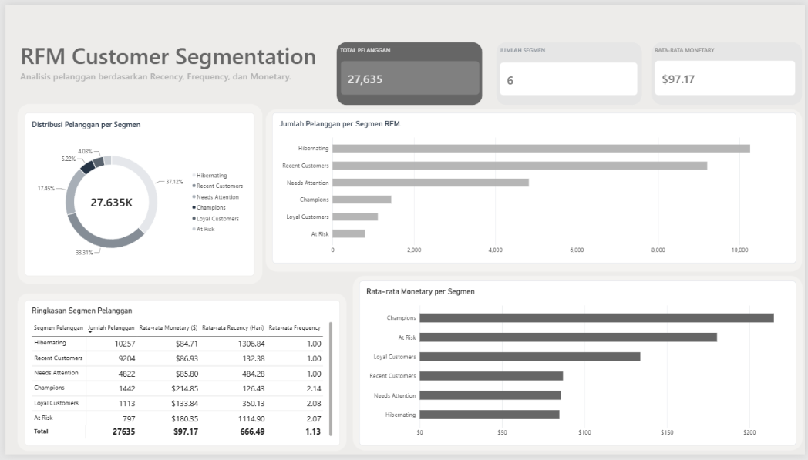

# RFM Customer Segmentation: BigQuery & Power BI

## 📌 Overview

Proyek ini bertujuan menganalisis pelanggan e-commerce menggunakan metode **RFM (Recency, Frequency, Monetary)** untuk memahami pola transaksi, mengidentifikasi segmen pelanggan, dan menghasilkan insight yang dapat mendukung strategi retensi serta reaktivasi pelanggan.

Analisis dilakukan menggunakan Google BigQuery untuk pengolahan data dan SQL, kemudian hasilnya divisualisasikan menggunakan Power BI dalam bentuk dashboard interaktif.

## 🎯 Objectives

1. Menghitung nilai Recency, Frequency, dan Monetary setiap pelanggan.
2. Memberikan skor RFM berdasarkan perilaku transaksi pelanggan.
3. Mengelompokkan pelanggan ke dalam enam segmen.
4. Menganalisis distribusi pelanggan dan rata rata Monetary setiap segmen.
5. Menyajikan hasil analisis melalui dashboard untuk mendukung pengambilan keputusan bisnis.

## 🛠️ Tools & Technologies

1. **Google BigQuery:** Pengolahan data dan analisis menggunakan SQL.
2. **SQL:** Perhitungan metrik RFM, pemberian skor, segmentasi, serta ringkasan hasil.
3. **Power BI:** Visualisasi dan penyajian hasil analisis.
4. **CSV:** Penyimpanan hasil olahan data untuk digunakan dalam dashboard.

## 📊 Data Source

Dataset yang digunakan adalah `bigquery-public-data.thelook_ecommerce`, yaitu dataset e-commerce publik yang tersedia di Google BigQuery.

Analisis RFM menggunakan data dari tabel `order_items` dengan fokus pada transaksi berstatus `Complete`.

Dataset ini bersifat sintetis, sehingga hasil analisis digunakan untuk latihan dan demonstrasi analisis data, bukan sebagai representasi langsung kondisi perusahaan nyata.

## 🔍 Methodology

### 1. Recency

Mengukur jumlah hari sejak transaksi terakhir pelanggan hingga tanggal acuan yang diambil dari tanggal transaksi terbaru dalam dataset. Semakin kecil nilai Recency, semakin baru aktivitas pelanggan.

### 2. Frequency

Menghitung jumlah pesanan unik (`order_id`) berstatus `Complete` yang dilakukan setiap pelanggan.

### 3. Monetary

Menghitung total nilai `sale_price` dari item pesanan berstatus `Complete` untuk setiap pelanggan. Nilai ini merepresentasikan nilai transaksi, bukan laba atau profit.

### 4. RFM Scoring

Pelanggan diberi skor berdasarkan metrik RFM. Recency dan Monetary menggunakan pembagian kuantil, sedangkan Frequency menggunakan aturan skor yang telah ditentukan berdasarkan distribusi jumlah pesanan.

### 5. Customer Segmentation

Pelanggan dikelompokkan menjadi enam segmen:

1. **Champions:** Pelanggan dengan kombinasi skor RFM yang tinggi.
2. **Loyal Customers:** Pelanggan dengan frekuensi transaksi yang tinggi.
3. **Recent Customers:** Pelanggan dengan aktivitas transaksi yang relatif baru.
4. **Needs Attention:** Pelanggan yang perlu mendapatkan perhatian melalui strategi pemasaran.
5. **At Risk:** Pelanggan yang berpotensi tidak aktif dan memerlukan strategi retensi.
6. **Hibernating:** Pelanggan dengan aktivitas transaksi yang sudah lama atau relatif rendah.

## 📈 Dashboard Overview

Dashboard Power BI menyajikan beberapa informasi utama:

1. Total pelanggan.
2. Jumlah segmen pelanggan.
3. Rata rata Monetary.
4. Distribusi pelanggan melalui donut chart.
5. Jumlah pelanggan pada setiap segmen RFM.
6. Perbandingan rata rata Monetary per segmen.
7. Tabel ringkasan metrik pelanggan berdasarkan segmen.

## 📊 Key Findings

Berdasarkan hasil analisis pada dashboard:

1. **Total pelanggan:** 27.635.
2. **Jumlah segmen pelanggan:** 6.
3. **Rata rata Monetary keseluruhan:** $97,17.
4. **Segmen Hibernating:** 10.257 pelanggan.
5. **Segmen Champions:** Rata rata Monetary sekitar $214,85.

Hasil tersebut menunjukkan bahwa distribusi pelanggan tidak merata di antara segmen dan nilai transaksi rata rata berbeda berdasarkan kelompok pelanggan.

## 💡 Business Recommendations

1. Mengembangkan kampanye reaktivasi untuk pelanggan Hibernating.
2. Mempertahankan pelanggan Champions melalui program loyalitas dan penawaran yang relevan.
3. Mengembangkan strategi untuk meningkatkan frekuensi pembelian pelanggan yang potensial.
4. Memprioritaskan kampanye pemasaran berdasarkan karakteristik setiap segmen.

Rekomendasi tersebut merupakan usulan awal berdasarkan hasil segmentasi dan perlu dievaluasi lebih lanjut sebelum diterapkan pada bisnis nyata.

## 📁 Project Structure

Struktur repository proyek terdiri dari beberapa folder berikut:

1. `README.md`: Dokumentasi utama proyek.
2. `dashboard/`: File dashboard Power BI.
3. `data/`: Dataset hasil olahan yang digunakan untuk dashboard.
4. `image/`: Screenshot dashboard untuk dokumentasi.
5. `sql/`: Kumpulan query SQL untuk eksplorasi distribusi Frequency, perhitungan RFM, ringkasan KPI, dan contoh pelanggan per segmen.
6. `sql/analisis_penjualan/`: Query tambahan untuk analisis pertumbuhan penjualan tahunan dan per kategori.

## 🚀 How to Use

1. Buka Google BigQuery.
2. Akses dataset publik `bigquery-public-data.thelook_ecommerce`.
3. Jalankan query SQL yang tersedia di folder `sql` sesuai urutan analisis.
4. Ekspor hasil query RFM ke CSV jika diperlukan.
5. Buka file `dashboard/dashboard_bigdata.pbix` menggunakan Power BI Desktop.
6. Sesuaikan sumber data jika lokasi file CSV berbeda dari lokasi awal.

## 👨‍💻 Project Scope

Proyek ini merupakan bagian dari pengembangan portofolio Data Analyst dengan fokus pada SQL, analisis perilaku pelanggan, segmentasi RFM, dan visualisasi data.

**Author:** Fathur Rahman

**Tools:** Google BigQuery, SQL, Power BI
